<div align="center">

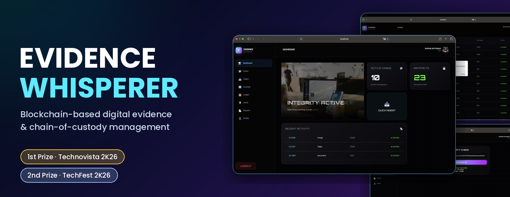

<br>

### Tamper-proof digital evidence and chain of custody, secured on the blockchain

<br>


[**Overview**](#-overview) · [**Product Tour**](#-product-tour) · [**Architecture**](#-architecture) · [**Smart Contract**](#-smart-contract) · [**Run Locally**](#-run-locally) · [**Author**](#-author)

</div>

<!-- DEMO VIDEO: paste your YouTube link here, for example: [▶ Watch the demo](https://youtu.be/...) -->

---

## 📌 Overview

**Evidence Whisperer** is a blockchain-based evidence management system built by **Sarthak Anil Kadam**. Police officers log digital evidence against investigation cases. Every item is recorded on an Ethereum smart contract, and every change of custody is written to a ledger that cannot be altered.

| | |
|---|---|
| 🔐 **Zero-trust onboarding** | Officers apply with badge ID, official email, photo and signature. The admin approves each request, and a one-time access code is emailed to the officer. |
| ⛓️ **Tamper-proof records** | Evidence ID, case ID, file reference, type and custodian are stored on-chain with a timestamp. |
| 🔁 **Chain of custody** | Transfer a whole case to another officer. The new custodian is written to the blockchain and a `CustodyTransferred` event is emitted. |
| ✅ **Integrity check** | Paste any evidence hash to confirm it is verified on-chain. |
| 📄 **Court-ready reports** | Generate a printable chain-of-custody report with the officer's photo, hashes and digital signature. |

---

## 🖥️ Product Tour

### 1. Secure login and officer enrollment

Officers sign in with their badge ID. New officers request access, and nothing is activated until the admin approves it.

<table>
<tr>
<td width="50%">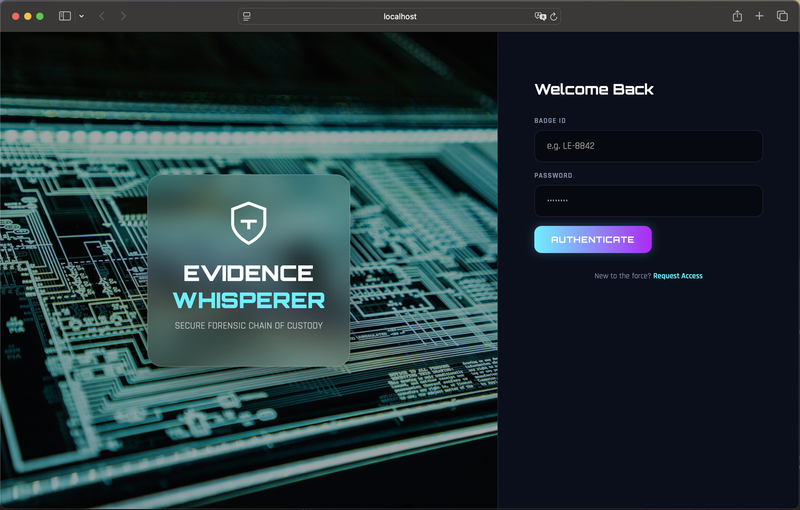</td>
<td width="50%">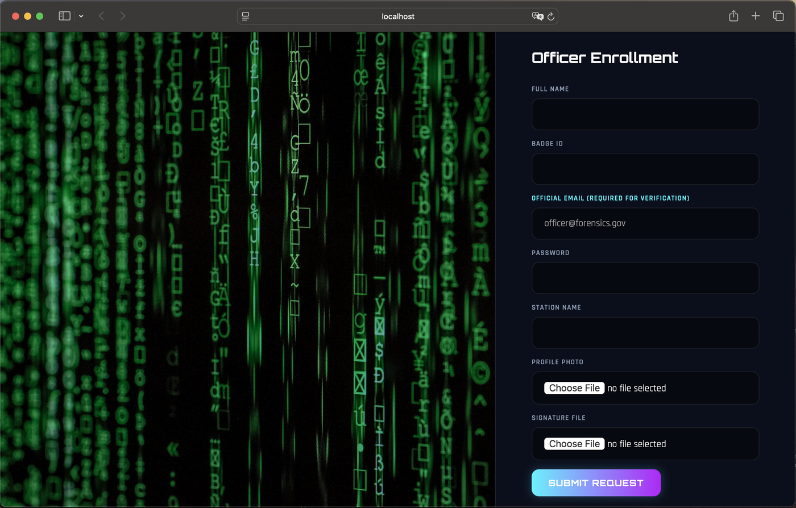</td>
</tr>
<tr>
<td align="center"><b>Login</b></td>
<td align="center"><b>Officer enrollment</b></td>
</tr>
</table>

### 2. Dashboard

Active investigations, secured artifacts and recent evidence activity at a glance, with a one-click quick ingest.

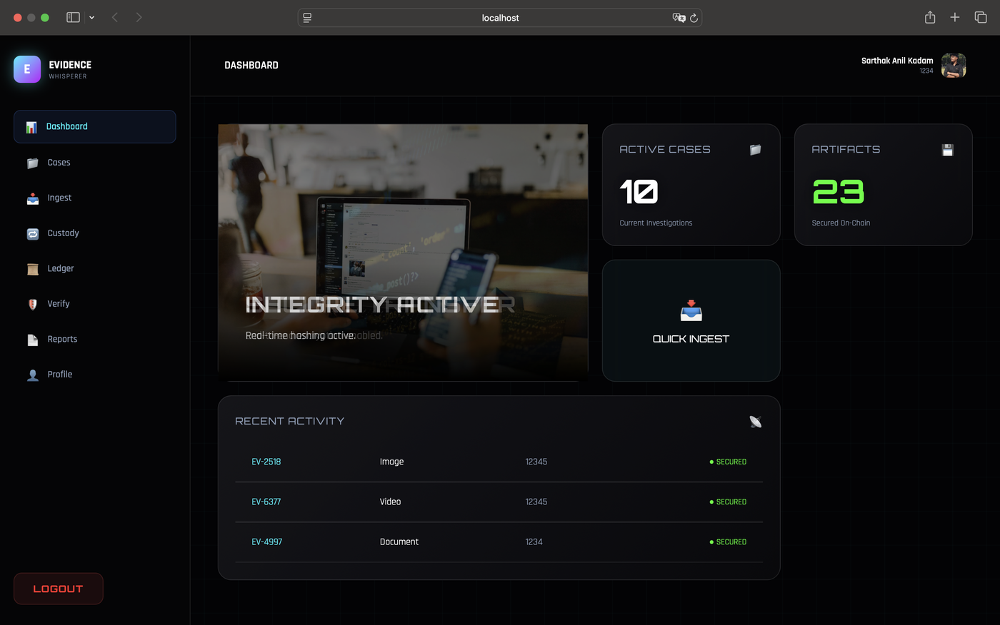

### 3. Case management

Every investigation gets a unique case ID. Open a case file to see all evidence attached to it.

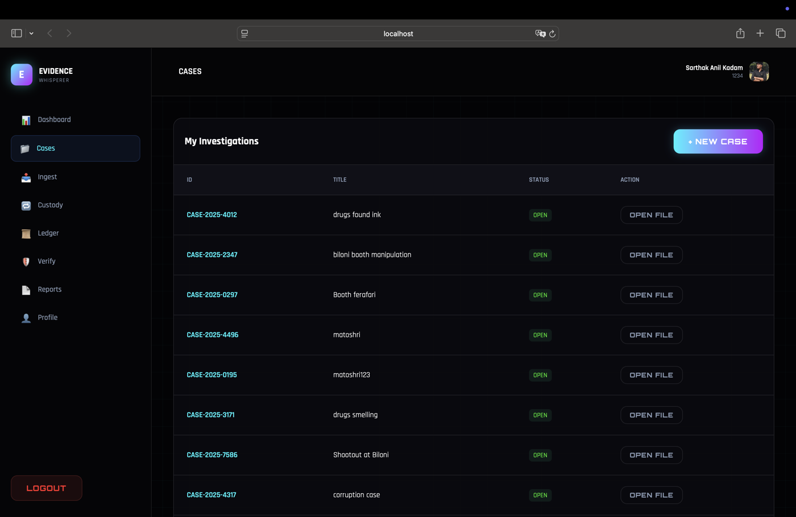

### 4. Evidence ingestion

Link evidence to a case, choose its type (image, video, document), add details and upload. The record is committed to the blockchain.

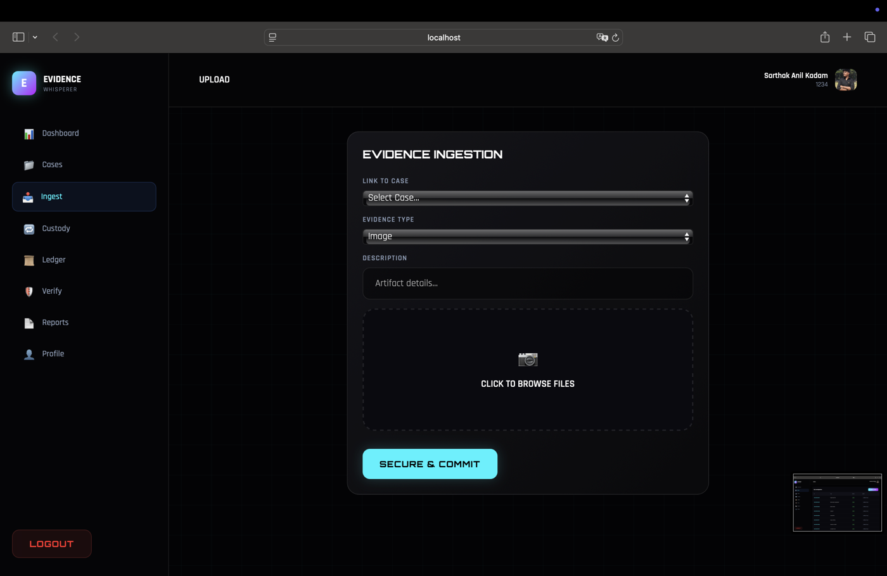

### 5. Custody transfer

Hand a case over to another officer. The change is recorded on-chain, so the full chain of custody can always be proven.

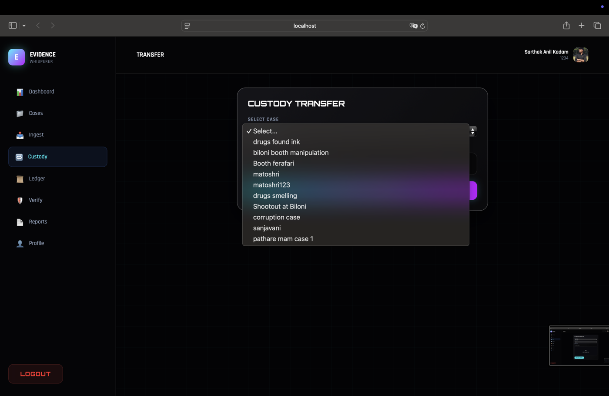

### 6. Blockchain ledger

Every evidence record read straight from the smart contract, with a hash, evidence ID, current custodian and a SECURED status. One click copies the full hash.

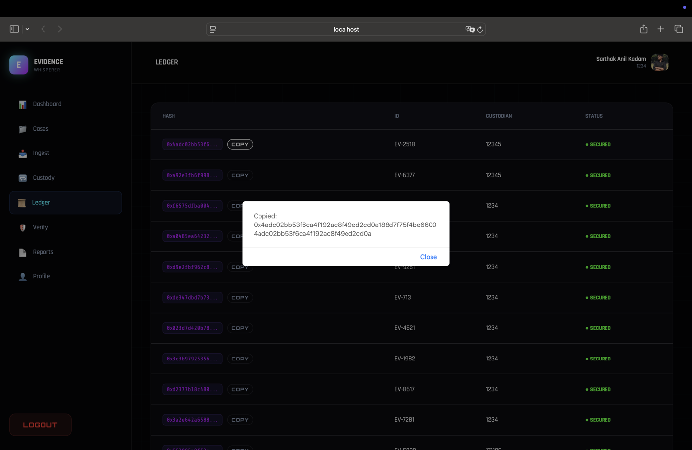

### 7. Integrity check

Paste a hash and the system confirms whether it exists on-chain, then shows the evidence ID and type.

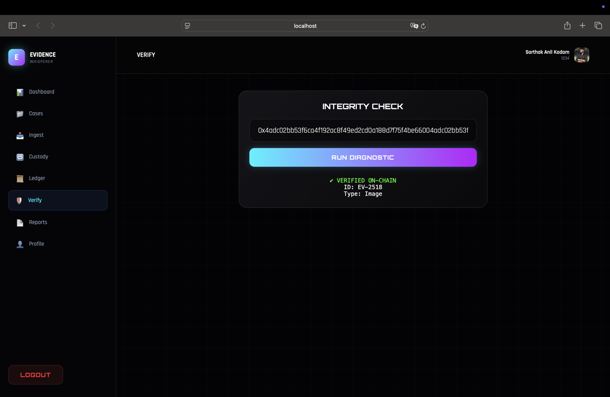

### 8. Chain-of-custody report

A clean, printable report with the case, officer, badge ID, date, every evidence hash and the officer's digital signature.

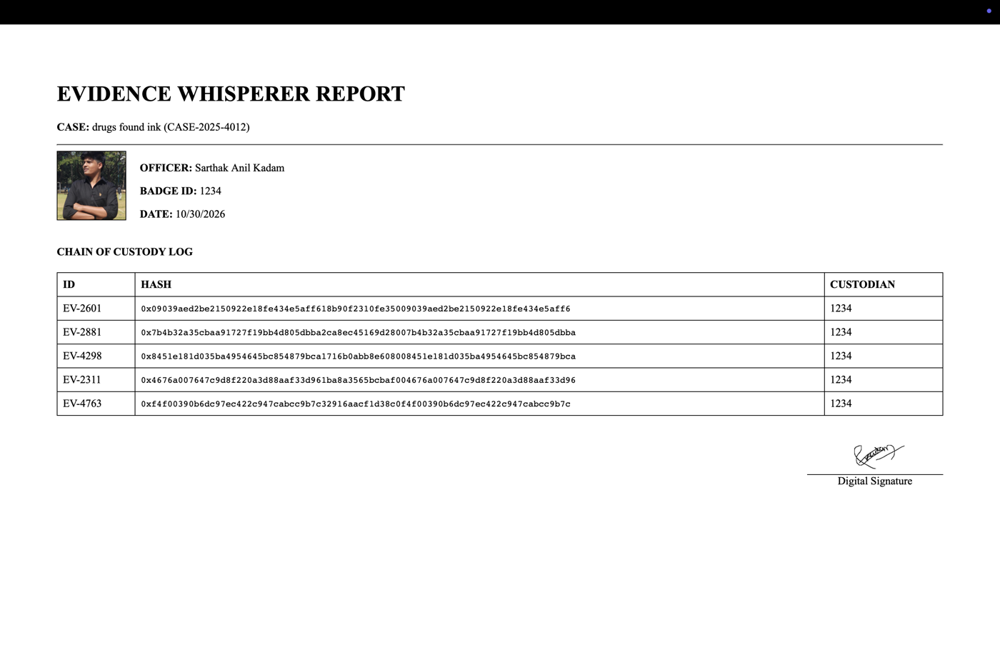

### 9. Admin command center

The administrator reviews pending requests, approves or revokes officers, and manages the roster.

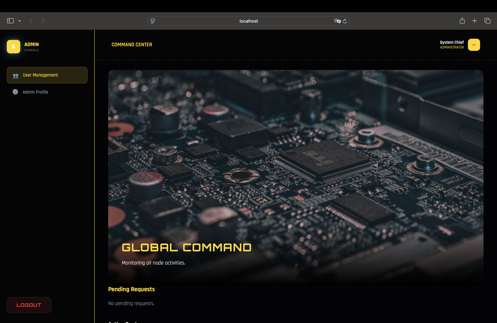

---

## 🏗️ Architecture

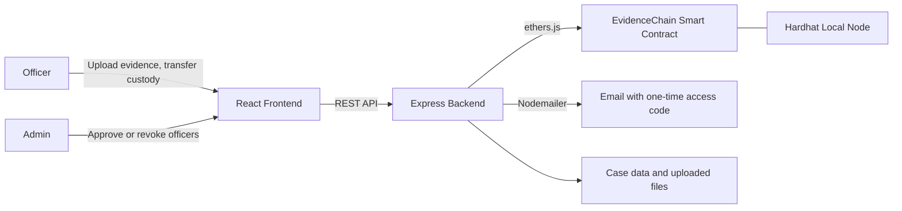

**How a piece of evidence flows through the system**

1. An officer registers and the admin approves the account.
2. The officer creates a case and uploads evidence.
3. The backend stores the file and calls `addEvidence` on the smart contract.
4. The ledger reads the records back from the blockchain with `getAllEvidence`.
5. When a case changes hands, `transferCustody` records the new custodian on-chain.

---

## 🧰 Tech Stack

| Layer | Technology |
|---|---|
| **Frontend** | React 19, Vite, Axios |
| **Backend** | Node.js, Express 5, Multer (file uploads), Nodemailer (email), ethers.js |
| **Blockchain** | Solidity 0.8.19, Hardhat, local Ethereum node |
| **Storage** | JSON database and local file storage (demo setup) |

---

## 📜 Smart Contract

`blockchain/contracts/EvidenceChain.sol`

| Function | What it does |
|---|---|
| `addEvidence(...)` | Records an evidence item with its case ID, file reference, type, custodian and timestamp |
| `transferCustody(id, newCustodian)` | Changes the custodian and emits a `CustodyTransferred` event |
| `getAllEvidence()` | Returns the complete evidence ledger |

---

## 🔌 API Endpoints

| Method | Endpoint | Description |
|---|---|---|
| `POST` | `/api/register` | Officer registration, pending admin approval |
| `POST` | `/api/login` | Login |
| `GET` | `/api/admin/users` | List all users (admin) |
| `POST` | `/api/admin/action` | Approve or revoke an officer (admin) |
| `GET` `POST` | `/api/cases` | List or create cases |
| `POST` | `/api/evidence` | Upload evidence and record it on-chain |
| `GET` | `/api/ledger` | Evidence ledger from the blockchain |
| `POST` | `/api/transfer-case` | Transfer case custody |

---

## 🚀 Run Locally

**Requirements:** Node.js 18 or newer and npm.

<details>
<summary><b>1. Start the blockchain</b></summary>

```bash
cd blockchain
npm install
npx hardhat node
```

Leave this terminal open. In a second terminal, deploy the contract:

```bash
cd blockchain
npx hardhat run scripts/deploy.js --network localhost
```

Copy the printed `CONTRACT_ADDRESS`.

</details>

<details>
<summary><b>2. Configure and start the backend</b></summary>

Create `backend/.env`:

```env
CONTRACT_ADDRESS=paste-the-address-here
RPC_URL=http://127.0.0.1:8545
EMAIL_USER=your-sender-email@gmail.com
EMAIL_PASS=your-gmail-app-password
ADMIN_PASSWORD=choose-a-strong-password
```

```bash
cd backend
npm install
node server.js
```

The API runs on `http://127.0.0.1:5001`.

</details>

<details>
<summary><b>3. Start the frontend</b></summary>

```bash
cd frontend
npm install
npm run dev
```

Open the URL Vite prints, usually `http://localhost:5173`.

</details>

<details>
<summary><b>4. First login</b></summary>

Log in with the admin account, approve a registered officer from the Command Center, then log in as that officer to create cases and upload evidence.

</details>

> **Note:** this repository does not include `node_modules`, uploaded files, user data or secrets. Run `npm install` in each folder and create your own `.env`.

---

## 🗺️ Roadmap

- [ ] Store evidence files on IPFS or cloud storage and keep the SHA-256 hash on-chain
- [ ] Replace the JSON database with MongoDB or PostgreSQL
- [ ] Hash passwords and use JWT authentication
- [ ] Deploy the contract to an Ethereum testnet
- [ ] Host the frontend and backend for a live demo

---

## 👨‍💻 Author

<div align="center">

**Sarthak Anil Kadam**
B.Tech CSE student at Pimpri Chinchwad University, Pune · Python Full-Stack Developer

[](https://www.linkedin.com/in/sarthak-anil-kadam/)
[](https://github.com/sarthak-anil-kadam)
[](https://leetcode.com/u/sarthak-anil-kadam/)

⭐ If you like this project, please star the repository.

</div>
